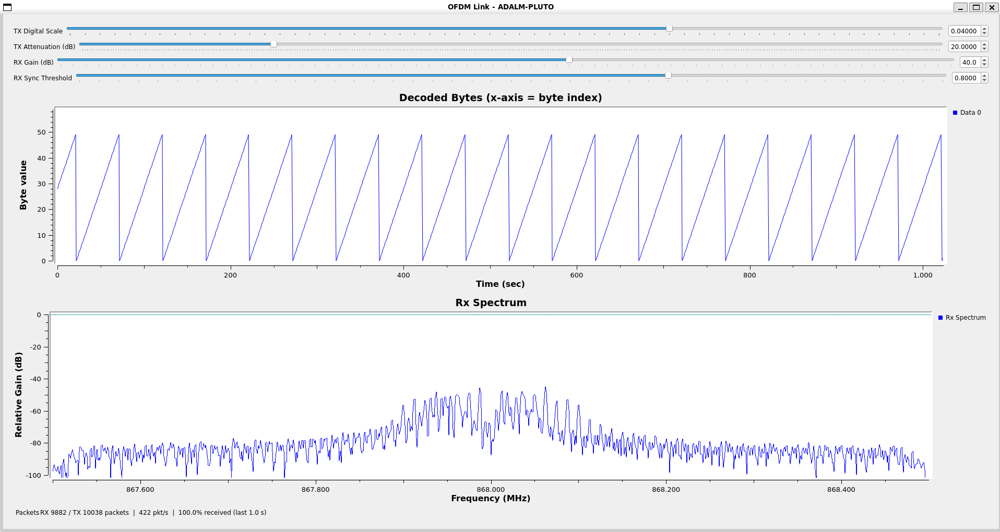
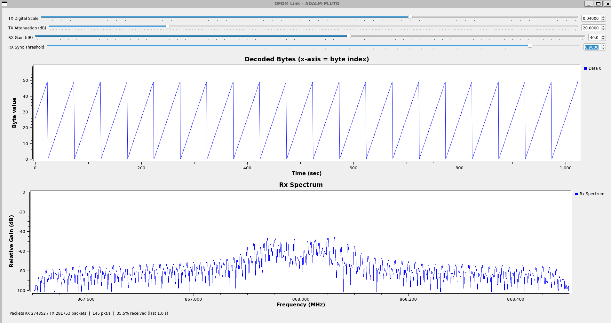
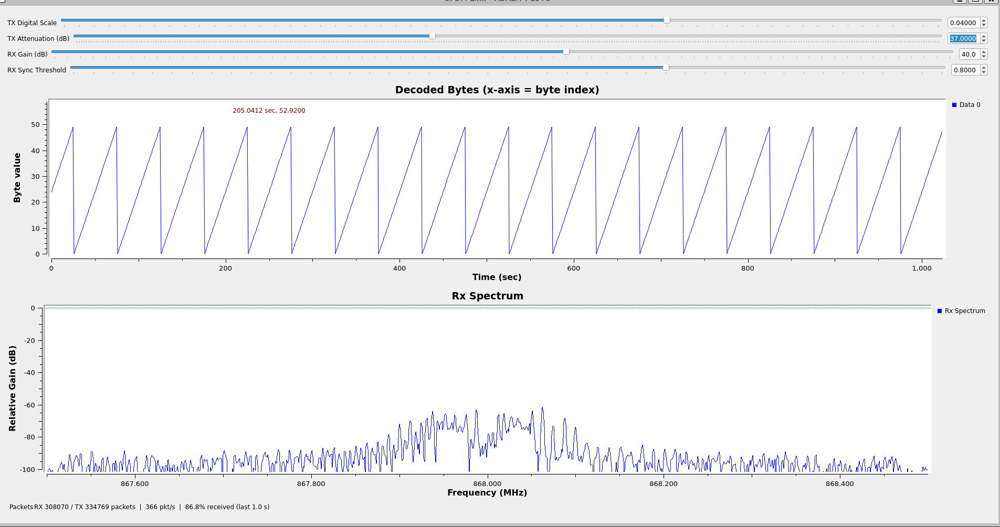
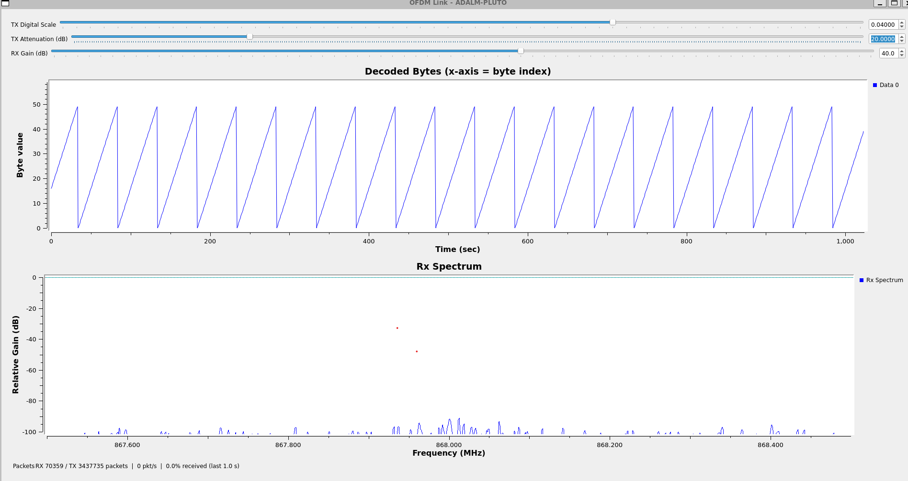

# OFDM Link on an ADALM-PLUTO

A GNU Radio flowgraph that sends OFDM packets over the air with an
[ADALM-PLUTO](https://www.analog.com/en/design-center/evaluation-hardware-and-software/evaluation-boards-kits/adalm-pluto.html)
and decodes them in real time, with live packet statistics.

It started from GNU Radio's simulated `ofdm_loopback` example. On the Pluto, the stock
OFDM Receiver block lost **~60 % of packets even with a strong signal**. The cause turned
out to be its hard-coded packet-detection threshold. This flowgraph uses a rebuilt
receiver with an adjustable threshold and reaches **100 %** packet reception.



> **Setup in short:** this is a **single-device loopback**. One Pluto transmits
> on TX1 and receives its own signal on RX1 at the same time (full duplex). It
> is **not** a link between two radios. See [Limitations](#limitations).

## Repository contents

| File | Description |
|---|---|
| `ofdm_link_pluto.grc` | Hardware version for the ADALM-PLUTO (main flowgraph) |
| `ofdm_link.grc` | Original simulated version (channel model, no hardware needed) |
| `docs/` | Screenshots |

## Requirements

Tested with:

| Component | Version |
|---|---|
| OS | Ubuntu 22.04.4 LTS (on WSL2, Windows) |
| GNU Radio | 3.10.1.1 (with `gr-iio`) |
| libiio | 0.23 |
| Pluto firmware | v0.32 |

On Ubuntu 22.04, the distribution packages include everything you need:

```bash
sudo apt install gnuradio libiio-utils
```

## Hardware setup

- One ADALM-PLUTO, connected by USB.
- The stock antennas that come with the Pluto, screwed directly onto its **TX** and **RX** ports.
- **Or** a coaxial cable from TX to RX **with at least 30 dB of attenuation in line**.
  Never connect TX straight to RX without an attenuator.

### Connecting to the Pluto

The flowgraph connects using the `pluto_uri` variable, which defaults to `ip:192.168.2.1`.
That is the Pluto's default address over its USB network interface. Check that it is reachable:

```bash
iio_info -u ip:192.168.2.1
```

- Set `pluto_uri` to `""` to auto-detect, or to `usb:x.y.z` to use libiio's direct USB connection.
- **WSL2:** USB devices are not visible inside WSL unless you pass them through with
  [`usbipd`](https://github.com/dorssel/usbipd-win). The `ip:` URI works without passthrough,
  because Windows handles the Pluto's network interface.
  At 1 MS/s it was fast enough: no samples were lost (see [Investigation](#investigation-why-the-stock-receiver-lost-packets)).

## Running

1. Open `ofdm_link_pluto.grc` in GNU Radio Companion.
2. Press **F6** (Execute). This generates the Python script and runs it.

### GUI controls

| Control | Default | What it does |
|---|---|---|
| **TX Digital Scale** | 0.04 | Amplitude of the baseband signal sent to the DAC. Max 0.058 (peak = full scale) |
| **TX Attenuation (dB)** | 30 | Pluto TX attenuation, 0–89.75 dB |
| **RX Gain (dB)** | 40 | Pluto RX gain (manual), 0–70 dB |
| **RX Sync Threshold** | 0.8 | Packet-detection threshold of the Schmidl & Cox detector (see below) |

### Displays

- **Decoded Bytes**: the decoded payload. A working link shows a repeating ramp from 0 to 49.
- **Rx Spectrum**: the raw received spectrum around the center frequency.
- **Packets**: received and transmitted packet counts, packet rate, and the percentage
  received correctly over the last second.

> The Decoded Bytes plot shows **only packets that decoded**, and it **freezes on its last
> image** when nothing decodes. It looks perfect even when most packets are lost.
> Always judge the link by the **% received** on the Packets line.

## Flowgraph overview

Full block diagram: [docs/flowgraph.pdf](docs/flowgraph.pdf). Or open `ofdm_link_pluto.grc` in GNU Radio Companion.

```
TX:  Vector Source (0..49) ─► Stream to Tagged Stream ─► OFDM Transmitter ─► Multiply Const (TX scale) ─► Pluto TX (FMComms2 Sink)
                                                              └─► Packet Counter (TX input)

RX:  Pluto RX ─┬─► Schmidl & Cox sync (threshold) ─┬─ freq. offset ─► Frequency Mod ─┐
               │                                   └─ packet start ─────────────────┐│
               ├─► Delay ──────────────────────────────────────────► Multiply ◄─────┘│
               │                                                        ▼            │
               │                                         Header/Payload Demux ◄──────┘
               │                     header ┌──────────────────┘    └──────────┐ payload
               │   FFT ► Channel est. ► Equalizer ► Serializer        FFT ► Equalizer ► Serializer
               │        ► BPSK decoder ► Header parser ──(header info back to the demux)
               │                                       ► QPSK decoder ► Repack bits ► CRC32 check
               │                                                                        ├─► Decoded Bytes plot
               │                                                                        └─► Packet Counter (RX input)
               └─► Rx Spectrum plot
```

### Parameters

| Parameter | Value | Notes |
|---|---|---|
| Center frequency | 868 MHz | EU ISM band (`center_freq`) |
| Sample rate | 1 MS/s | `samp_rate` |
| RF bandwidth | 1 MHz | |
| FFT length | 64 | Subcarrier spacing 15.625 kHz |
| Cyclic prefix | 16 samples | `fft_len // 4` |
| Data subcarriers | 8 | ±1…±4 (`occupied_carriers`) |
| Pilot subcarriers | 4 | ±5, ±6 (`pilot_carriers`) |
| Occupied bandwidth | ≈ 190 kHz | ±93.75 kHz |
| Header / payload modulation | BPSK / QPSK | `header_mod` / `payload_mod` |
| Payload | 50 bytes per packet | Each packet has a CRC32; packets that fail it are dropped |
| Packet length on air | 2400 samples | 30 OFDM symbols of 80 samples |
| Packet rate | ≈ 416 packets/s | 1 MS/s ÷ 2400 |
| Payload throughput | ≈ 166 kbit/s | 416 × 50 × 8 |

### Implementation notes

- **Rebuilt OFDM receiver.** The stock **OFDM Receiver** block (`digital.ofdm_rx`) is replaced by the
  blocks it builds internally (17 blocks), taken from GNU Radio's own `ofdm_rx` code: the same sync
  words, header format and equalizers. The payload descrambler is left out, because it does nothing
  when scrambling is off (as it is here). The only other difference is that the Schmidl & Cox detector's
  threshold is exposed as a slider. With the threshold at 0.9, the rebuilt chain gives exactly the
  same result as the stock block on the same recording (935 packets), which confirms it is
  equivalent. The OFDM parameters (carriers, pilots, modulation) are shared variables used by both
  the transmitter and the receiver, so the two cannot get out of sync.
- **FMComms2 Sink instead of PlutoSDR Sink.** In GNU Radio 3.10.1, the PlutoSDR Sink's TX
  attenuation callback calls `set_attenuation(value)` without the channel argument. Moving the
  slider throws a `TypeError`, and the attenuation doesn't change. The FMComms2 Sink creates the
  same driver object (`iio.fmcomms2_sink_fc32`) with a correct callback. Only TX1 is enabled.
- **TX scaling.** The OFDM Transmitter output is not normalized (peaks ≈ 17). Without the
  Multiply Const block, the DAC would clip heavily.
- **Packet Counter.** An embedded Python block. It counts the `packet_len` tags on the OFDM
  Transmitter output and the `rx_len` tags after the CRC check. A Function Probe reads it once per
  second. The TX and RX totals always differ by about 20 packets, because that many are in flight
  in the buffers at any moment.
- **Optional IQ recording.** Two File Sinks (`rx_capture`, `tx_capture`) are included but
  **disabled**. Enable them (select the block and press E) to record raw RX and TX samples for
  offline analysis. They write about 8 MB/s each at 1 MS/s, so record only a few seconds.

## Results

All measurements: TX scale 0.04, RX gain 40 dB, stock antennas on the Pluto's TX and RX ports.

### The fix: sync threshold 0.9 → 0.8

At 20 dB TX attenuation, with only the RX Sync Threshold changed:

| Threshold | Packets received | |
|---|---|---|
| 0.9 (value hard-coded in the stock OFDM Receiver) | **35.5 %** |  |
| 0.8 | **100 %** |  |

Over a run of about 11 minutes at threshold 0.8, **97.6 %** of all packets were received
(274,852 of 281,753). That total includes a short period at 0.9 for the comparison above.

The same comparison on a 10-second IQ recording, decoded offline:

| Threshold | Packets decoded (≈ 2500 sent) |
|---|---|
| 0.9 | 935 (37 %) |
| 0.8 | 2499 (100 %, all payloads correct) |
| 0.7 | 2499 (100 %) |

### Link margin

TX attenuation was raised in steps, with threshold 0.8:

| TX attenuation | Packets received | Screenshot |
|---|---|---|
| 20 dB | 100 % | [view](docs/gui_fixed_threshold_0.8.png) |
| up to ≈ 36 dB | ≥ 90 % | |
| 37 dB | 86.8 % (first step below 90 %) | [view](docs/gui_37dB_below_90pct.png) |
| 39.25 dB | 63.2 % | [view](docs/gui_39dB.png) |
| 42.25 dB | 21.2 % | [view](docs/gui_42dB.png) |
| 46 dB | 3.1 % | [view](docs/gui_46dB.png) |
| 48.75 dB | 0 % | [view](docs/gui_49dB_zero.png) |

So there is about **16 dB of margin** above the 20 dB working point before packet loss exceeds 10 %.



## Investigation: why the stock receiver lost packets

With the stock OFDM Receiver, only **30–46 %** of packets arrived, whatever the settings.
Neither TX attenuation (5–20 dB) nor sample rate (1 MS/s vs 600 kS/s) made a difference.
A 10-second IQ recording (600 kS/s) was analyzed offline to find the cause.

**Ruled out:**

| Suspect | Measurement | Verdict |
|---|---|---|
| Samples lost on the USB / WSL link | All 500 packet preambles present in 2 s, exactly 2400 samples apart; average data rate ≈ 4.1–4.3 MB/s each way | no loss |
| CPU overload | No thread anywhere near 100 % | fine |
| Carrier frequency offset | 0.00 Hz (TX and RX share one oscillator) | none |
| DC offset | −78 dB relative to signal | negligible |
| I/Q imbalance | Image at −27 dB | minor |
| Transmitted signal | The TX recording decodes 2499 / 2499 | clean |

**Root cause: packet detection.**

1. The real SNR of the received packets is about **19–20 dB**. That is lower than the spectrum
   plot suggests, because the Pluto's **transmitter adds noise inside the signal band**. This
   noise scales with the transmit level, which is why changing TX attenuation didn't help.
2. The OFDM Receiver finds packets with a **Schmidl & Cox detector** (`ofdm_sync_sc_cfb`), whose
   threshold is fixed at **0.9** inside the block. In simulation with white noise, that detector
   finds every packet at 19 dB SNR and almost none at 15 dB. Its limit falls off sharply in exactly
   the range where this signal sits.
3. On the recording, the detector triggered on only **211–227 of 500** packets at 0.9, and on
   **all 500** at 0.8. Every packet it detects then decodes correctly.

**What did not help much:** low-pass filtering the input (±75–120 kHz) raised offline decoding
only from 37 % to 43 %, because most of the noise is inside the band.

**Trade-off of a lower threshold:** with no signal present, a lower threshold makes false
detections on noise more likely. Each false detection is rejected by the header check or the
CRC, so it costs a little processing but never produces wrong data. 0.8 was enough here.
0.7 also worked on the recording.

## Troubleshooting

| Symptom | Likely cause / fix |
|---|---|
| `No device found` / connection error | Check `iio_info -u ip:192.168.2.1`. On WSL, use the `ip:` URI or pass the USB device through with `usbipd`. |
| Only 30–50 % received with a strong signal | Sync threshold too high: check that RX Sync Threshold is 0.8 or lower. |
| Packets at 0 %, no visible signal | Lower TX attenuation or raise RX gain. Check the antennas. |
| Spectrum peaks close to 0 dB, distorted | RX is overloaded: lower RX gain or raise TX attenuation. |
| Spectrum distorted, broad skirts | TX clipping: lower TX Digital Scale. |
| TX Attenuation slider does nothing | You are using the PlutoSDR Sink block in GNU Radio 3.10.1 (see implementation notes). |

## Limitations

- **Single-device loopback.** TX and RX share the same oscillator, so there is no carrier
  frequency offset or sample-clock drift between them. A link between two separate Plutos
  is harder for OFDM sync: each Pluto's crystal is accurate to about ±25 ppm, which can mean
  20+ kHz of offset at 868 MHz.
- **Internal leakage is small.** With the RX antenna unscrewed (TX attenuation 20 dB),
  the received signal drops from about −52 dB to about −90 dB, and decoding stops (0 %).
  Leakage inside the board is therefore about 40 dB below the over-the-air signal: the
  link works through the antennas, not through the board. The measured margin still
  applies only to antennas a few cm apart on the same device, not to a real range.

  

- **Spectral skirts.** `rolloff = 0` in the OFDM Transmitter means no windowing between
  symbols, so some energy leaks outside the occupied band.
- **Narrow signal.** Only 12 of 64 subcarriers are used, so about 81 % of the 1 MHz band is empty.

### Possible improvements

- **More occupied subcarriers** (e.g. 48 data + 4 pilots, as in 802.11a/g): about 6× more
  throughput, with the same detector working on a band the signal actually fills.
- **TX windowing** (`rolloff` > 0) to reduce out-of-band emissions.
- **A two-Pluto link**, with frequency calibration (`xo_correction`) or a shared reference clock.

## Regulatory note

868 MHz is a licence-free band in the EU, but it has limits on transmit power and duty
cycle (see ETSI EN 300 220 and your national regulator). This flowgraph transmits
continuously. You are responsible for complying with the rules in your country:
use a cable with attenuators, or keep the power low.

## Credits

- Based on the `ofdm_loopback` example shipped with GNU Radio (GPLv3). The receiver chain
  follows GNU Radio's `ofdm_rx` implementation and its `rx_ofdm.grc` example.
- My changes: Pluto hardware integration, TX scaling and gain controls, the packet counter,
  the rebuilt receiver with an adjustable sync threshold, and the investigation and
  measurements above.
